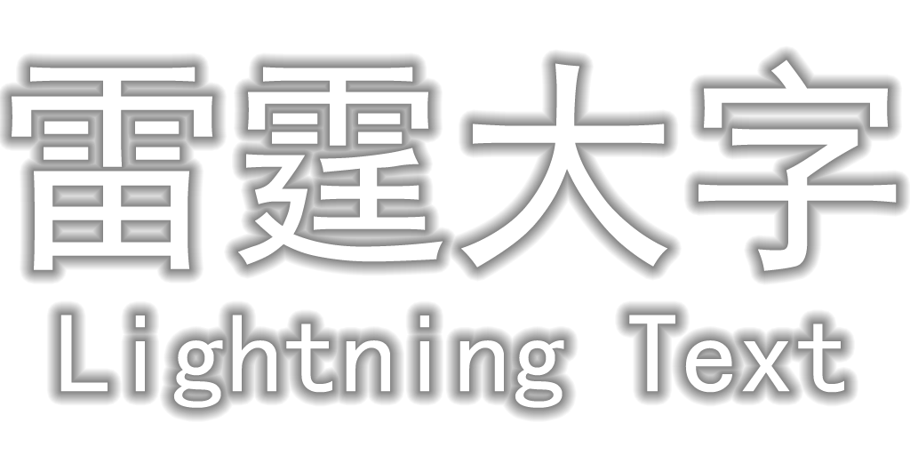

> ### 🐋 AI-generated content disclosure
> This mod was initially generated by AI.

# Lightning Text

Adjusts the visual appearance of the Vanilla `/title` command, using system fonts to render the text.

Also provides additional features such as Day Counter, Biome, Structure and Dimension Display.

On multiplayer servers, structure banners require the optional server-side [Servux](https://github.com/maruohon/servux) mod (or its NeoForge port, ServuxForged). ServuxForged is server-side only and must not be installed on the client; use a build that is compatible with the server's NeoForge version.

> **ServuxForged note:** on NeoForge 21.1.262 use ServuxForged 0.2.2 together with a newer Forgified Fabric API (0.116.15+2.3.6+1.21.1), otherwise its bundled payload codec cannot encode the structure data. ServuxForged 0.4.1 fails earlier with a MobEntity mixin error on this NeoForge version. The project's `runServer` already adds this working combination; install it on real servers as well. The client should also have Forgified Fabric API installed (but not ServuxForged); this is the combination that was verified end-to-end.

The visual presentation draws inspiration from *Control* and *Arknights: Endfield*.